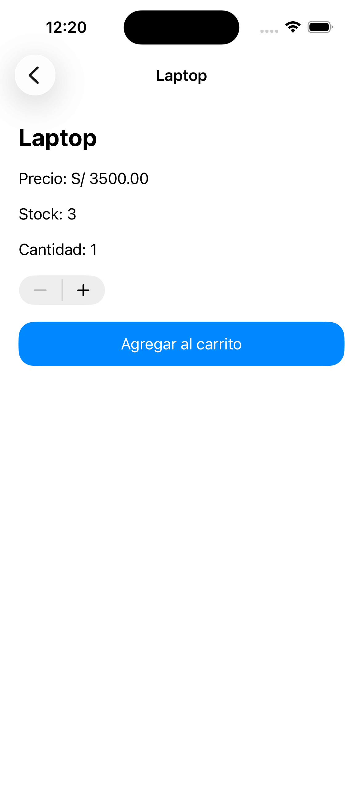
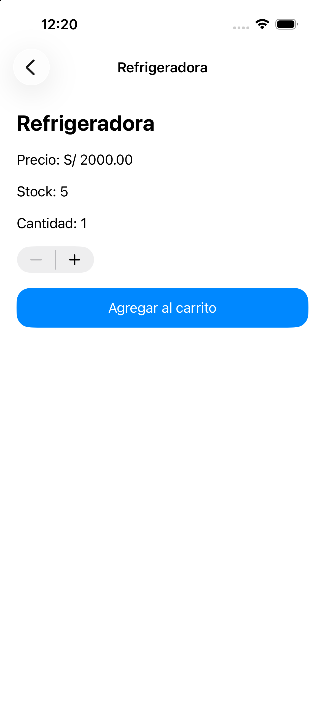
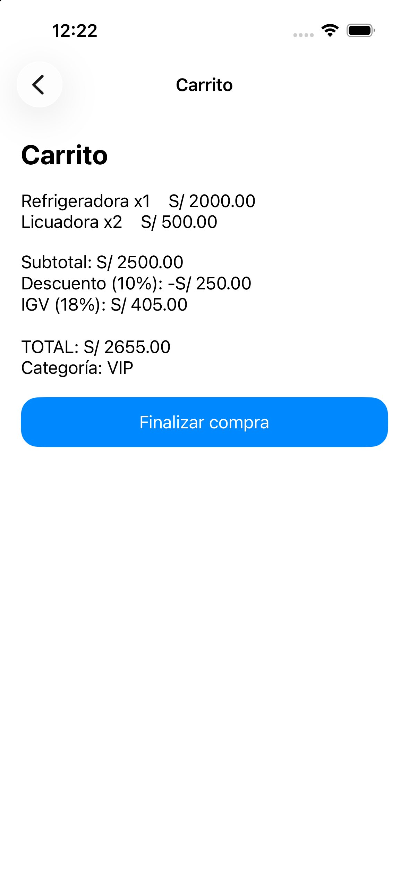
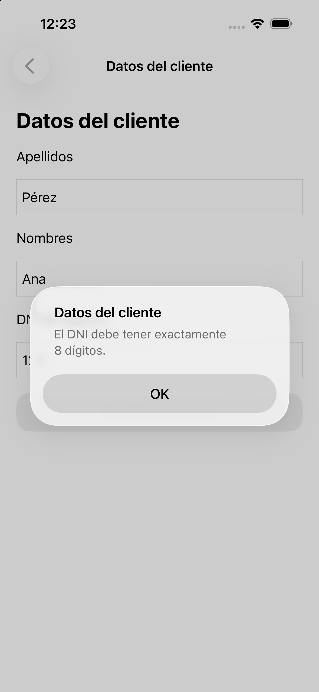
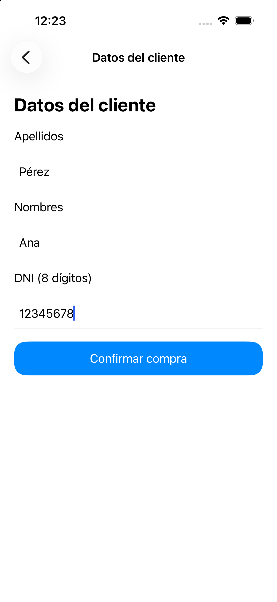
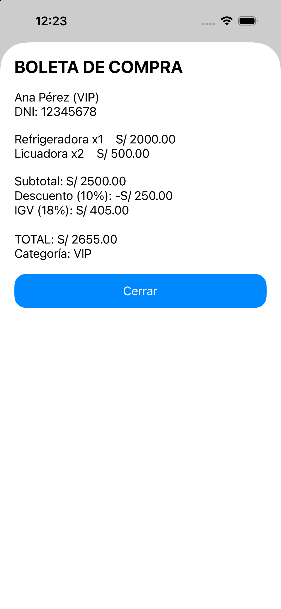
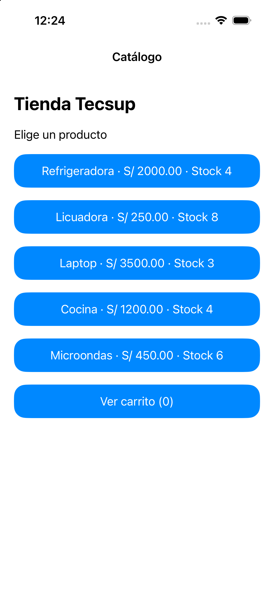
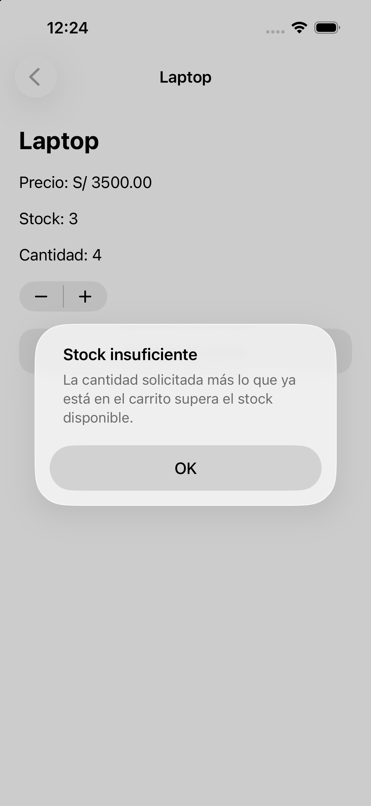

# Laboratorio 06 Caso integrador Tienda de Electrodomésticos

Rama: `integrador`. Proyecto: `Semana06_Integrador_Tienda`.

Aplicación UIKit de cinco pantallas basada en Laboratorio06-UIKit-Navegacion_Desarrollo.pdf.

## Autoría y alcance

La implementación fue realizada con asistencia de IA a solicitud del estudiante. La guía indica “sin IA” y diseño a mano en Storyboard; esta entrega no se presenta como trabajo sin IA ni como un diseño dibujado manualmente. La interfaz está definida en Main.storyboard, editable en Interface Builder; los controladores no crean vistas ni constraints mediante código Swift. Debe revisarse con el docente si esta modalidad de asistencia satisface su condición de autoría.

Se implementa el caso integrador. Los ejercicios previos de manual y ai-assisted conservan sus ramas y archivos.

## Abrir en Xcode

Abre `Semana06_Integrador_Tienda.xcodeproj`, selecciona el esquema `Semana06_Integrador_Tienda` y el destino **iPhone 16**. Ejecuta con Cmd + R. No necesita paquetes externos, internet ni configuración de firma para el simulador.

Abre Main.storyboard para ver y editar las cinco escenas, el UINavigationController, outlets y segues.

## Navegación y paso de datos

| Origen | Destino | Segue | Datos |
| --- | --- | --- | --- |
| Catálogo | Detalle | Show `verDetalle` | Producto y carrito |
| Catálogo | Carrito | Show `verCarrito` | Carrito |
| Carrito | Datos del cliente | Show `irDatosCliente` | Carrito |
| Datos del cliente | Boleta | Present Modally `verBoleta` | Carrito y cliente |

Todos los segues salen del controlador, y se ejecutan con `performSegue(withIdentifier:sender:)`. Los cinco botones de producto comparten la acción `productoTapped` y el único segue `verDetalle`. Los tags 0 a 4 corresponden al orden del array.

El carrito se instancia una sola vez en CatalogoViewController. Los otros controladores reciben esa misma referencia en `prepare(for:sender:)`. Los outlets del destino se usan después, en `viewDidLoad` o `viewWillAppear`.

## Modelos y reglas

- Producto: nombre, precio y stock.
- ItemCarrito: producto y cantidad; calcula el subtotal de la línea.
- CarritoModel: agrupa productos por identidad, valida stock acumulado y calcula subtotal, descuento, IGV, total, cantidad y categoría.
- ClienteModel: reutilizado del ejercicio 2, con código, apellidos, nombres y DNI.

Datos iniciales: Refrigeradora S/ 2000, stock 5; Licuadora S/ 250, stock 10; Laptop S/ 3500, stock 3; Cocina S/ 1200, stock 4; Microondas S/ 450, stock 6.

Descuentos sobre subtotal: 5 % desde S/ 500; 10 % desde S/ 2000; 15 % desde S/ 5000. El IGV de 18 % se aplica al importe después del descuento.

La categoría usa `switch Int(subtotal())`: Regular, Frecuente, VIP y Premium con los límites de la guía.

## Confirmación y validaciones

- No se aceptan cantidades que excedan el stock, incluidas las unidades que ya están en el carrito.
- Los tres campos del cliente son obligatorios; DNI de exactamente ocho dígitos ASCII.
- Cada error de entrada se muestra mediante UIAlertController.
- La boleta copia sus textos antes de confirmar el modelo, bajar el stock y vaciar el carrito.
- Cerrar hace dismiss y vuelve al catálogo con `popToRootViewController` (reto opcional 1).
- `viewWillAppear` actualiza el contador y el stock visible al volver.
- Carrito vacío deshabilita Finalizar compra.
- El stock y el carrito viven en memoria. Una nueva ejecución inicia nuevamente los datos fijos; la guía no solicita persistencia.

## Prueba final del quinto producto

Microondas se agregó en un archivo Storyboard y un archivo Swift.

En Storyboard se añadió un botón, tag 4, conectado a la acción existente y a la colección de botones. En Swift se añadió una entrada al array de productos. No se necesitó otro segue ni cambiar el modelo o las otras pantallas. Esta respuesta también figura como comentario en CatalogoViewController.

## Verificación

| Escenario de la guía | Resultado verificado |
| --- | --- |
| 1. Refrigeradora x1 y Licuadora x2 | Subtotal 2500; descuento 250; IGV 405; total 2655; VIP |
| 2. Laptop x1 y Licuadora x1 | Subtotal 3750; descuento 375; IGV 607.50; total 3982.50; VIP |
| 3. Laptop x4 | Rechazado, sin modificar carrito |
| 4. Dos visitas a Licuadora x1 | Una sola línea Licuadora x2 |
| 5. Confirmar escenario 1 | Stocks 4 y 8; carrito vacío |

Los cinco escenarios pasaron en las pruebas Swift. En iPhone 16 se comprobaron visualmente los escenarios 1, 3, 4 y 5, campos vacíos, DNI inválido, cambio de cantidad y presentación modal. El escenario 2 se verificó mediante la prueba del modelo.

Para ejecutar las pruebas desde esta carpeta:

```sh
swiftc Semana06_Integrador_Tienda/Modelos.swift Pruebas/VerificarIntegrador.swift -o /tmp/verificar-integrador
/tmp/verificar-integrador
```

La prueba también verifica límites de descuento/categoría, DNI, compra repetida y Microondas. Su archivo está fuera de la carpeta de fuentes del target para evitar otro punto de entrada.

## PREDICT

1. El carrito es el mismo objeto. Se crea una sola vez en el catálogo y se comparten referencias a esa instancia; por eso otras pantallas ven las unidades agregadas.
2. Si fuera struct, cada asignación entregaría una copia. Agregar en el detalle no modificaría automáticamente el carrito del catálogo; haría falta devolver el nuevo valor o usar otro mecanismo de sincronización.

## Seis checkpoints

1. Proyecto UIKit y Storyboard inicial.
2. Modelos, cálculos y validaciones.
3. Catálogo, detalle y estructura de cinco pantallas.
4. Carrito y datos del cliente.
5. Boleta modal, confirmación y Microondas.
6. Pruebas, documentación y evidencias.

## Evidencias en iPhone 16










Consulta [PROMPTS.md](PROMPTS.md) para la documentación de la asistencia.
