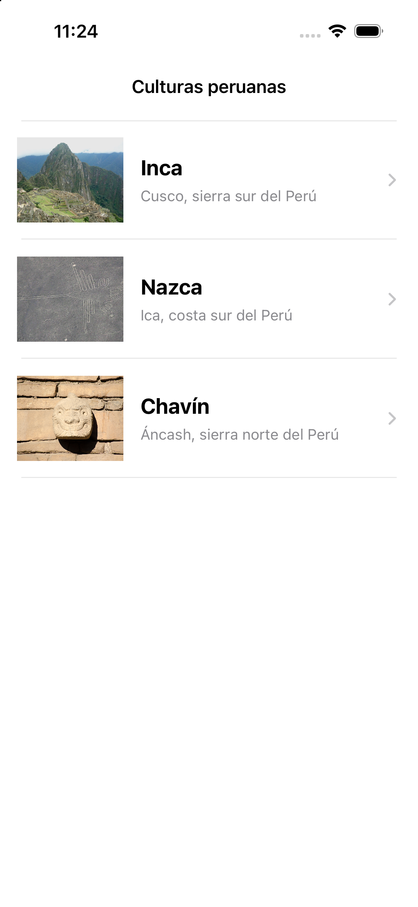
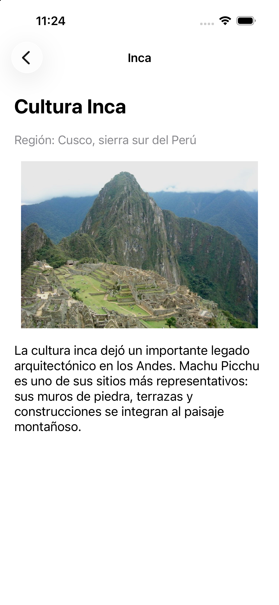
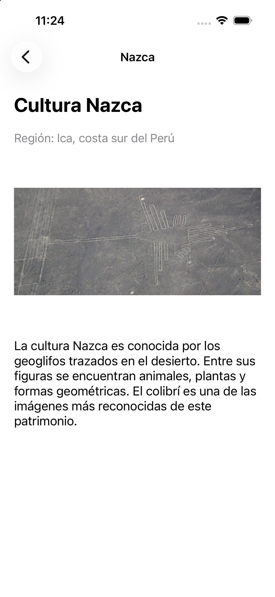
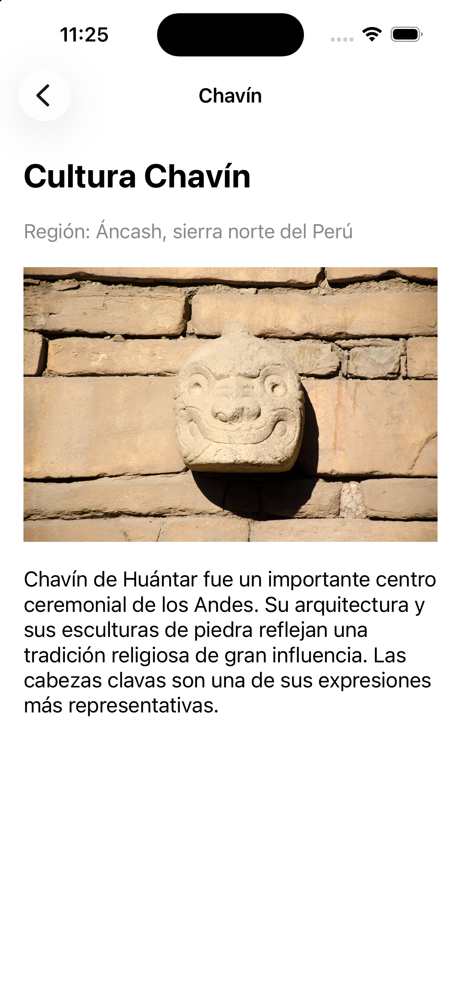
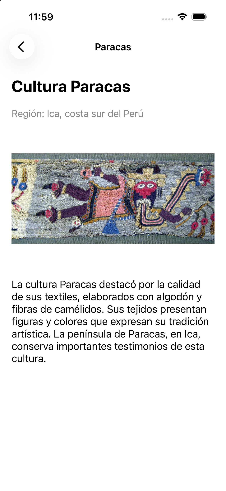

# Laboratorio 07 Culturas peruanas

Caso a desarrollar de la guía GLAB-S07-JLEONS-2026-2, implementado en la rama `ai-assisted`.

## Proyecto

`Semana07_03_CulturasPeruanas/Semana07_03_CulturasPeruanas.xcodeproj`

Aplicación UIKit con Storyboard, UITableView y UINavigationController. Presenta las culturas Inca, Nazca, Chavín y Paracas, con imágenes locales y una pantalla de detalle.

## Funcionamiento

La tabla obtiene sus datos de `Cultura.ejemplos`. Cada celda reutilizable `culturaCell` muestra nombre, región e imagen mediante los outlets de `CulturaTableViewCell`.

Al tocar una celda se ejecuta el segue **Show** `mostrarDetalleCultura`, conectado visualmente desde la celda al controlador de detalle. `prepare(for:sender:)` identifica la fila y entrega su modelo `Cultura` a `DetalleCulturaViewController`.

El detalle muestra nombre, región, descripción e imagen de esa cultura. La barra de navegación permite volver a la lista. El contenido está dentro de un UIScrollView para permitir desplazamiento en pantallas pequeñas.

## Conexiones y constraints

- `dataSource` y `delegate` de la tabla conectados al ViewController.
- Outlet de la tabla y tres outlets de la celda conectados en Main.storyboard.
- Cuatro outlets de la vista de detalle conectados en Main.storyboard.
- Cuatro bordes de la tabla a la Safe Area con constante **0**.
- Los márgenes interiores de la celda y del detalle permiten separar texto e imágenes.

## Ejecutar y editar

1. Abre el .xcodeproj del caso.
2. Selecciona el esquema `Semana07_03_CulturasPeruanas`.
3. Selecciona **iPhone 16** y ejecuta con Cmd + R.
4. Toca cualquier cultura, comprueba sus datos y vuelve para seleccionar otra.
5. Edita la interfaz en `Base.lproj/Main.storyboard` y los datos en `Cultura.swift`.

Las imágenes están incluidas en Assets. No se necesitan paquetes externos ni conexión a internet para ejecutar.

## Documentación y fuentes

- [Prompt simulado y criterios de revisión](README_PROMPT.md).
- [Fuentes de los textos e imágenes](FUENTES.md).

## Evidencias

## Ampliación: ocho lecturas adicionales

Las cuatro culturas principales se conservan. Cada detalle tiene el subtítulo **Otras culturas para explorar** y dos botones:

| Cultura principal | Lectura 1 | Lectura 2 |
| --- | --- | --- |
| Inca | Wari | Tiwanaku |
| Nazca | Chincha | Lima |
| Chavín | Cupisnique | Moche |
| Paracas | Chimú | Chancay |

Son sugerencias educativas para comparar otras sociedades, no subculturas ni una genealogía. Tiwanaku incluye el ámbito andino de Perú y Bolivia; la fotografía corresponde a su centro en Bolivia.

En Main.storyboard se conservan las cuatro constraints de la tabla a 0. El detalle y la lectura usan Scroll View, Stack View y constraints de contenido con margen de 20 para permitir el desplazamiento. Las escenas y conexiones son editables en Interface Builder; la ampliación fue realizada con asistencia mediante edición del XML, no arrastrando controles manualmente.

Flujo: lista → mostrarDetalleCultura (Show) → detalle con dos opciones → verCulturaRelacionada (Show) → lectura. El modelo seleccionado se pasa con prepare(for:sender:). La lectura no encadena más sugerencias. Usa Atrás para regresar y escoger la segunda opción.

Verificación: compilación correcta y recorrido de las ocho opciones y regreso en iPhone 16. Todas las imágenes se incluyen en Assets; no se requieren dependencias ni conexión a internet.

Evidencias de la ampliación:

- [Opciones dentro de Inca](evidencias/06_opciones_inca_iphone16.png).
- [Lectura de Wari](evidencias/07_lectura_wari_iphone16.png).
- [Opciones dentro de Chavín](evidencias/08_opciones_chavin_iphone16.png).

Dos checkpoints de esta ampliación: navegación y conexiones Storyboard; contenido de las ocho culturas, imágenes, fuentes y evidencia.
