# Semana 09 — Boleta de pago

App SwiftUI de una pantalla, alineada al Excel proporcionado el 28/10/2026. Se actualiza el mismo proyecto BoletaPago en la rama manual.

## Entrega y ejecución

- [Proyecto Xcode](BoletaPago/BoletaPago.xcodeproj).
- [Excel de referencia](outputs/grupo-b/Boleta_Pago_Grupo_B.xlsx).
- [Word de evidencias](outputs/grupo-b/Evidencias_BoletaPago.docx).
- [Fuentes y alcance](FUENTES.md).

Abre BoletaPago.xcodeproj, selecciona el esquema BoletaPago y el simulador iPhone 16 y pulsa Run. No requiere paquetes ni internet para calcular. Para iPhone físico configura tu equipo de firma. ContentView mantiene `#Preview { ContentView() }` y el proyecto incluye Assets.xcassets.

El XLSX se conserva intacto con cinco hojas, notas, fórmulas y gráficos. SHA-256: `50eb4e769513c3fb36abe28a849b1b181a7b655621f34566a1f6605564dbaf2e`. Se sustituyeron el Excel y las capturas anteriores para evitar versiones contradictorias.

## Resultados alineados

| Caso | Ingresos | Descuentos | Neto | EsSalud |
| --- | ---: | ---: | ---: | ---: |
| 1 | 2500.00 | 325.00 | 2175.00 | 225.00 |
| 2 | 1743.00 | 226.59 | 1516.41 | 156.87 |
| 3 | 3253.00 | 621.27 | 2631.73 | 292.77 |
| 4 | 3574.00 | 562.83 | 3011.17 | 321.66 |
| Propio 1 ONP | 1600.00 | 208.00 | 1392.00 | 144.00 |
| Propio 2 Habitat | 4000.00 | 513.60 | 3486.40 | 360.00 |
| Boleta activa | 3698.84 | 624.92 | 3073.92 | 332.90 |

El selector incluye los seis casos y la Boleta activa. La app inicia con esta última: sueldo 4000, 26 días, hijos Sí, Habitat, dos horas al 25%, tres al 35% y adelanto 150. Profesional, puesto, oferta y periodo son campos editables. Los datos del Excel se presentan como simulación; no se afirma un salario ni vínculo laboral real de la persona de referencia.

## Correspondencia con las fórmulas

| Hoja Boleta | Regla | Swift |
| --- | --- | --- |
| B23 | Sueldo / 30 × días | Boleta.calcular, sueldo computable |
| B24 | RMV × 10% si tiene hijos | Asignación familiar |
| B25 y B26 | Sueldo / 30 / 8 × 1.25 o 1.35 × horas | Extras |
| B27 | Sumar remuneraciones | Array y reduce |
| B31 | Ingresos × 13%, solo ONP | Descuento ONP |
| B32 a B34 | Fondo, comisión y seguro según AFP | Parametros.afps |
| B35 y B36 | Adelanto y suma de descuentos | Array descuentos |
| B40 y B41 | Ingresos × 9% y costo empresa | Aportaciones y ResultadoBoleta |
| A43 | Ingresos menos descuentos | ResultadoBoleta.neto |

AFP Guía: fondo 10%, comisión 1.60%, seguro 1.35%. Habitat: 10%, 1.47%, 1.37%. Integra: comisión 1.55%; Prima: 1.60%; Profuturo: 1.69%. Son tasas del Excel, no una consulta en vivo. Cada concepto se redondea a dos decimales antes de sumar; el valor hora conserva precisión intermedia.

Se siguen las fórmulas del libro: sin quinta categoría, CTS, gratificaciones, mínimo de EsSalud ni tope de seguro no aplicado en ellas. Es un modelo educativo, no una planilla legal completa.

## Flujo en una pantalla

Casos.todos carga los campos @State. El botón usa Entrada.decimal, crea DatosMes y llama a Boleta.calcular. ResultadoBoleta contiene arrays de Concepto y propiedades calculadas para los totales. ContentView presenta los tres bloques y el neto sin segues ni pantallas adicionales. Cambiar una entrada borra el resultado anterior hasta recalcular.

Los errores de formato, sueldo no positivo, días fuera de 1–30 y extras o adelantos negativos impiden el cálculo. Los controles de formato son más estrictos que las fórmulas del libro para no calcular datos inválidos.

## Verificación

28/10/2026: compilación correcta para iPhone 16; únicamente aviso del SDK sobre App Intents. Siete ejemplos comprobados en Swift y ejecutados en la interfaz. Comparación de 98 importes contra el XLSX y repetición con una copia recalculada por LibreOffice. Validación de días 31 y eliminación del resultado anterior. Las imágenes Excel son renders del libro, no capturas de Microsoft Excel.

```sh
swiftc SEMANA_09/BoletaPago/BoletaPago/Parametros.swift SEMANA_09/BoletaPago/BoletaPago/Modelos.swift SEMANA_09/BoletaPago/BoletaPago/Boleta.swift SEMANA_09/BoletaPago/BoletaPago/Casos.swift SEMANA_09/BoletaPago/Pruebas/main.swift -o /tmp/boleta-pruebas
/tmp/boleta-pruebas > /tmp/boleta-resultados.json
python3 SEMANA_09/BoletaPago/Pruebas/verificar_excel.py SEMANA_09/outputs/grupo-b/Boleta_Pago_Grupo_B.xlsx /tmp/boleta-resultados.json
```

## Evidencias

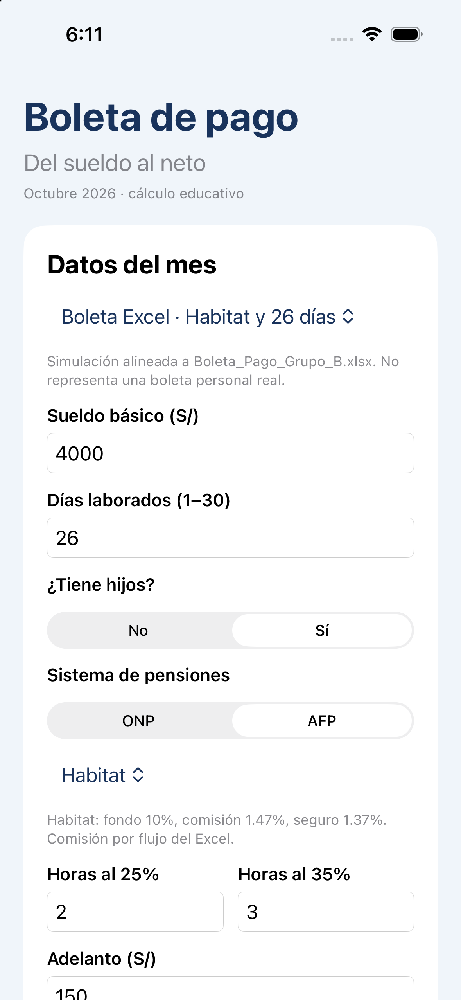
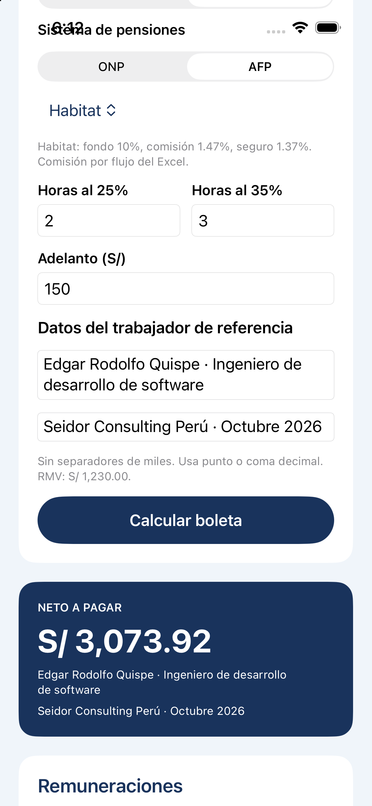
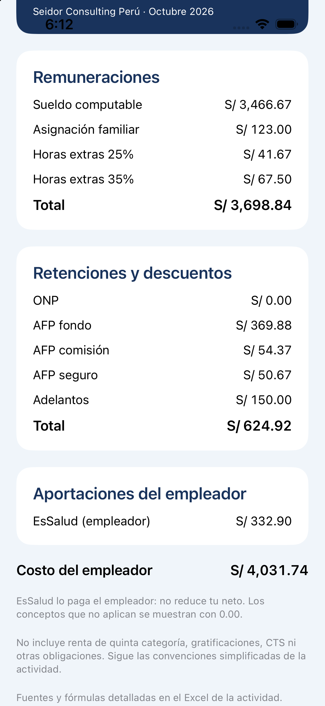
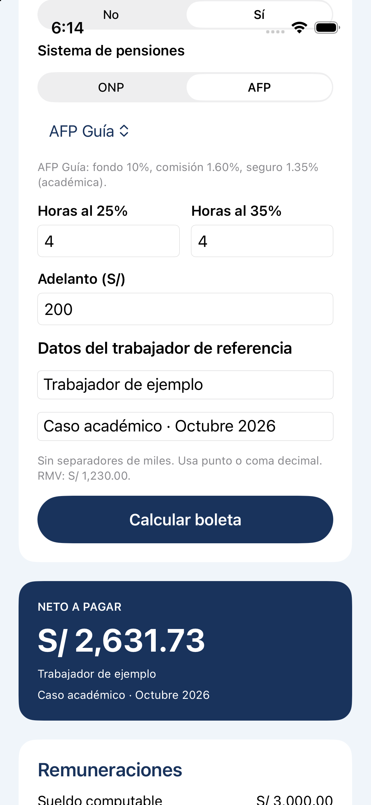
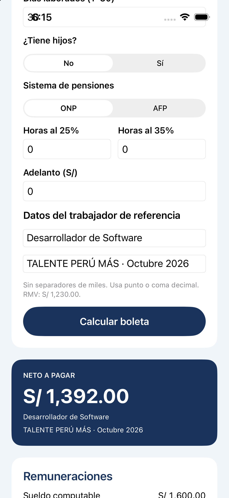
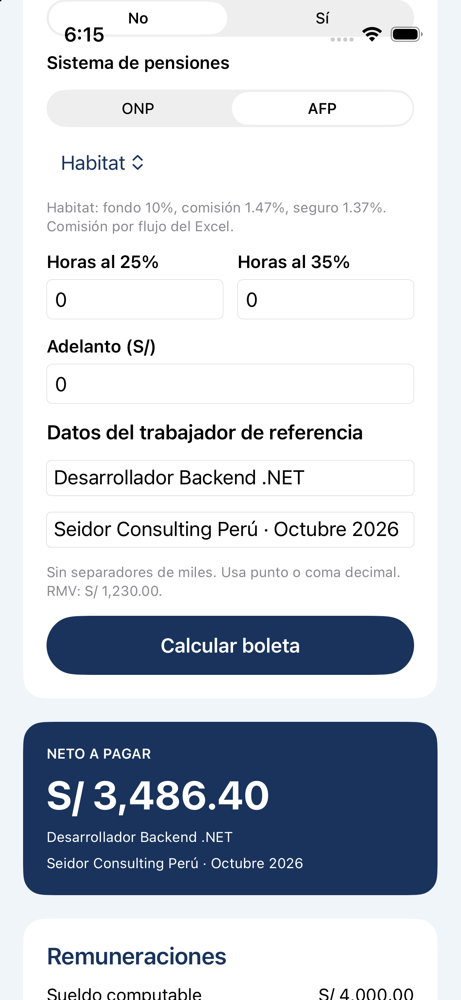
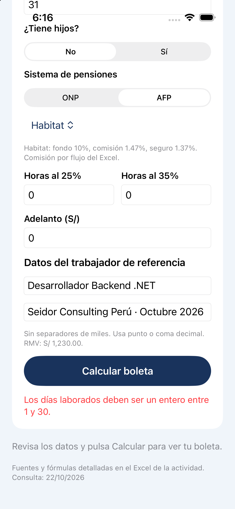
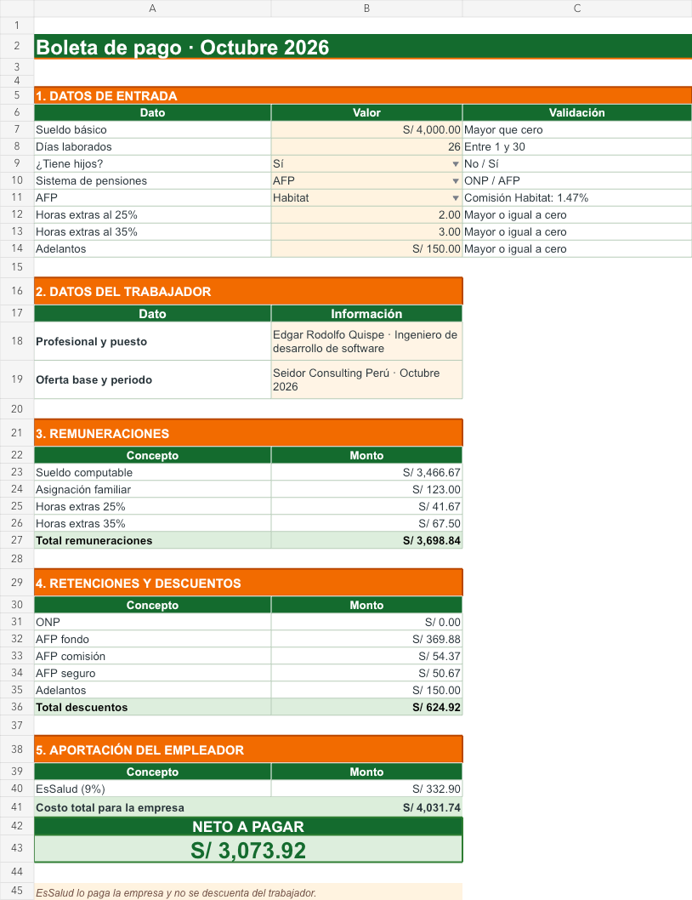
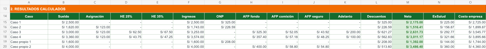
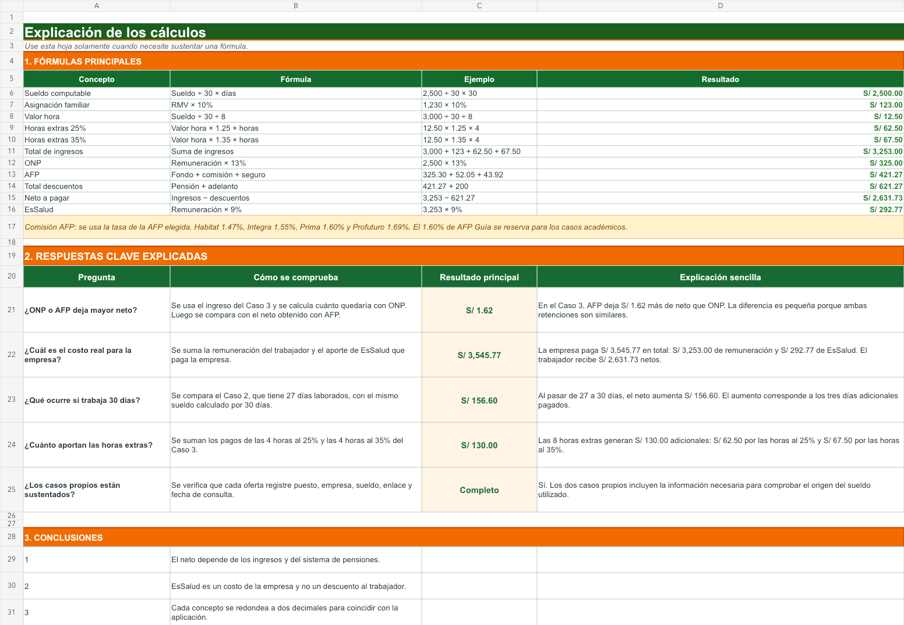
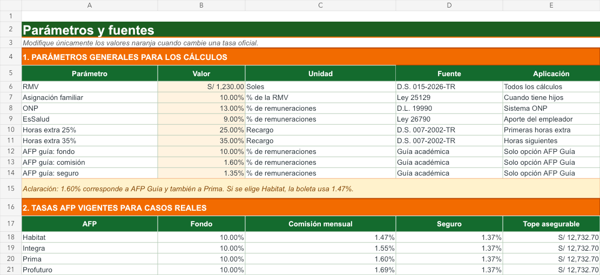
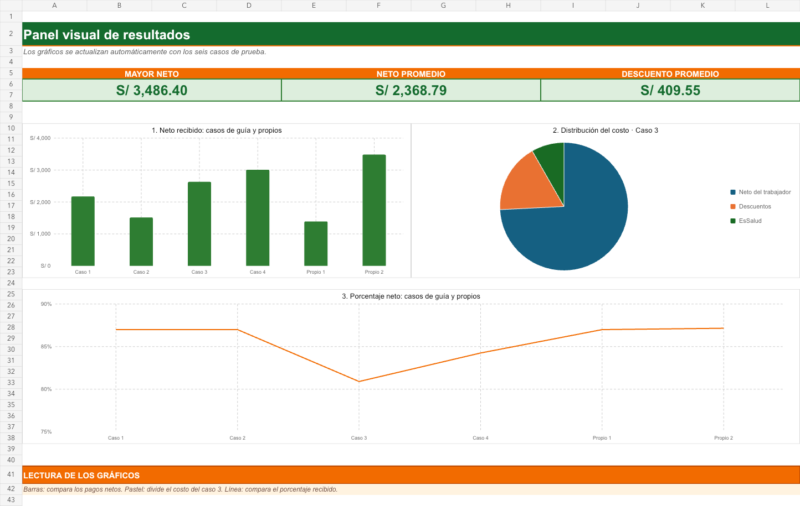
