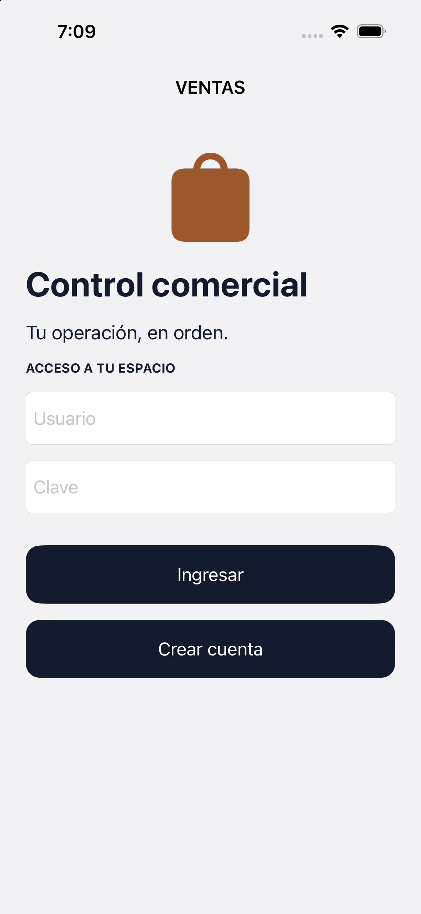
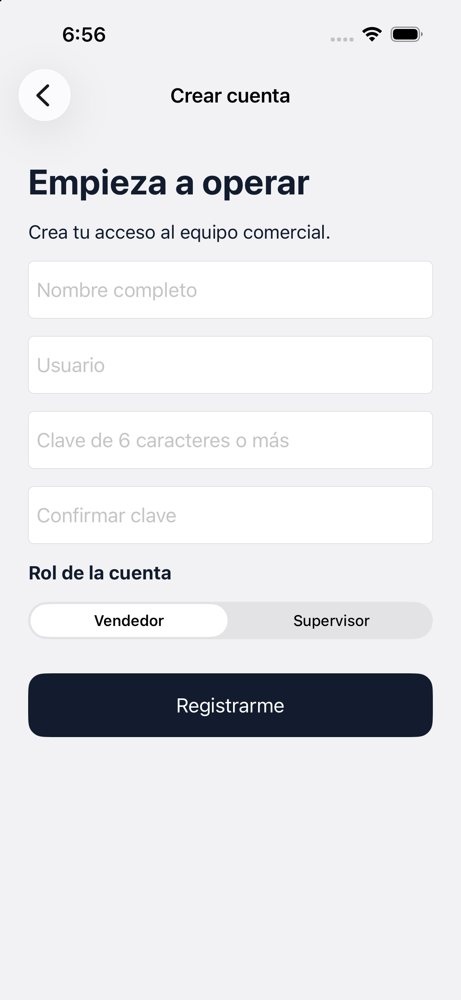
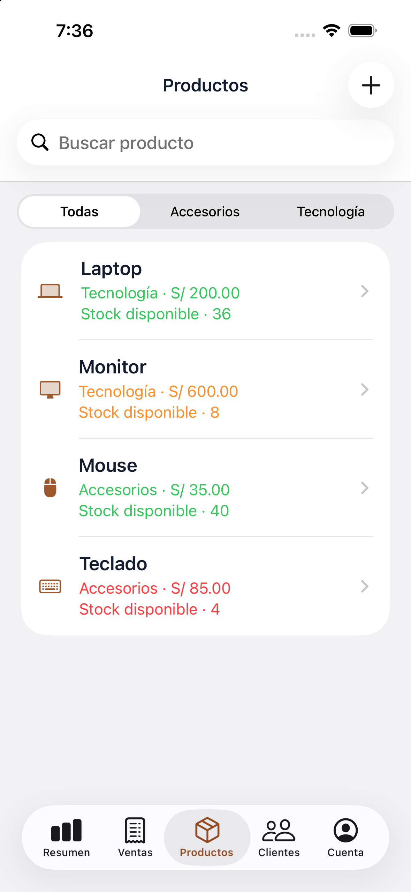
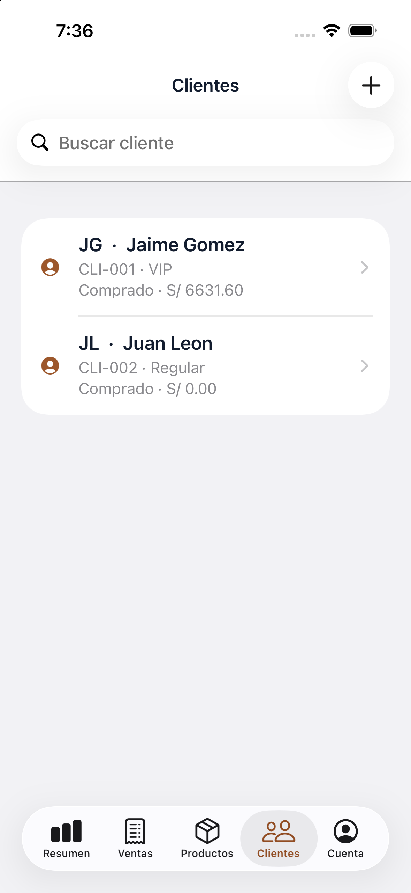
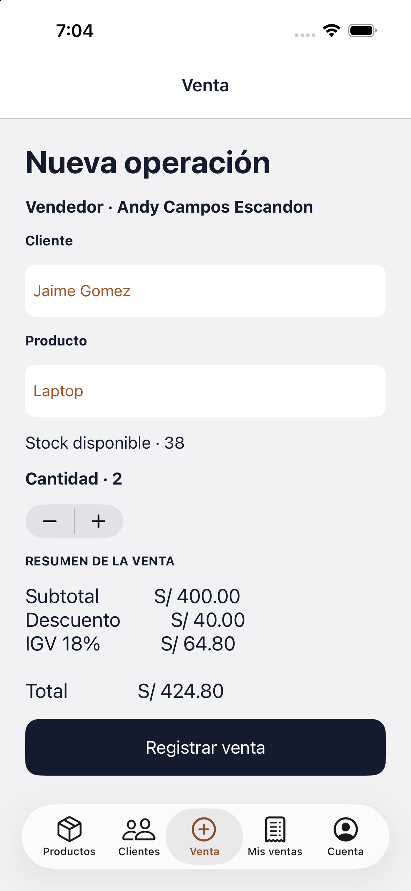
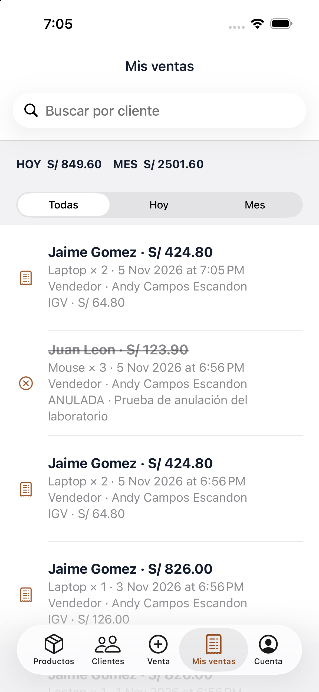
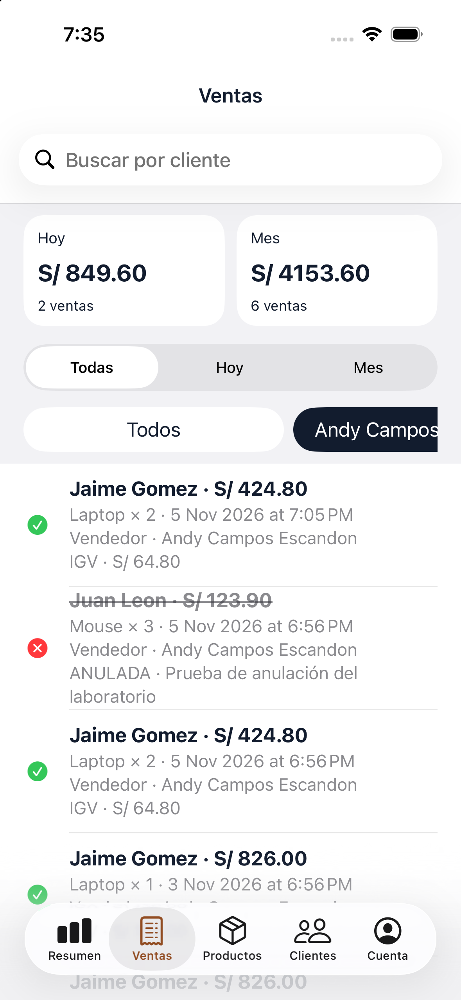
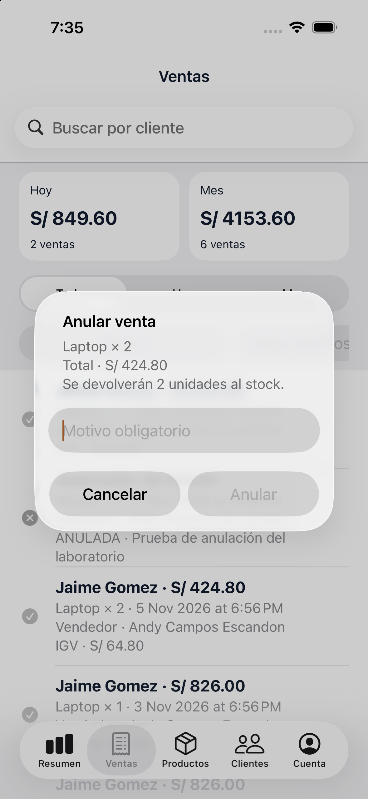
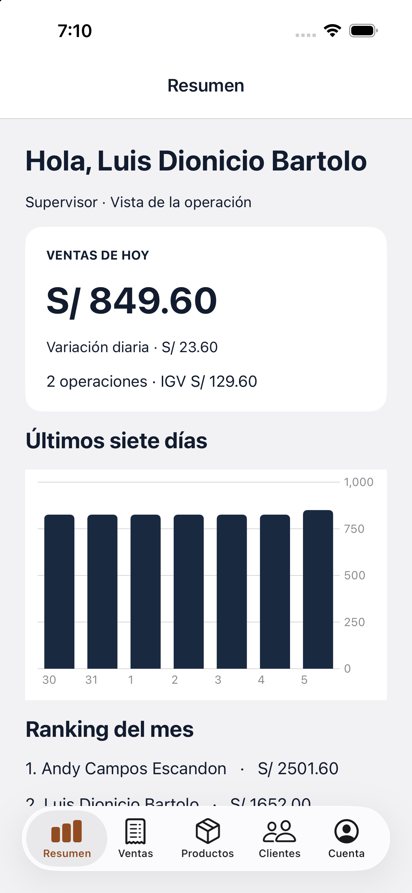
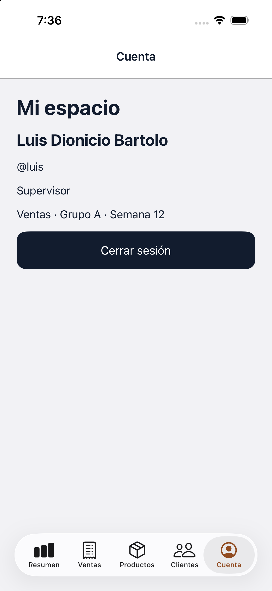

# Ventas · Grupo A · Semana 12

App académica UIKit + Core Data. Diseño azul marino, grafito, blanco y cobre. Entrega en `Ejercicio`, según lo solicitado por Luis. Fuente: GLAB-S11-JLEONS-2026-02, caso Grupo A (páginas finales).

## Ejecutar

Abre `Ventas.xcodeproj` con Xcode 27, elige esquema **Ventas**, destino **iPhone 16**, y pulsa ▶. No usa paquetes externos. En una instalación nueva, crea tu usuario con **Crear cuenta**. La app no incluye botón de demostración ni carga automática de registros.

| Usuario | Clave académica | Rol |
|---|---|---|
| luis | Ventas123 | Supervisor |
| andy | Ventas123 | Vendedor |
| luis.ventas | Ventas123 | Segundo vendedor |

También puedes crear una cuenta. La sesión se cierra al terminar el proceso; Core Data conserva usuarios, productos, clientes y ventas localmente. Clonar incluye el modelo, no la base privada del simulador. Las cuentas de la tabla son las utilizadas en las pruebas locales; al clonar debes registrar tus propias cuentas.

## Funcionamiento y código

| Parte | Archivo | Comportamiento |
|---|---|---|
| A1–A2 y Cuenta | `Ventas/App.swift` | Login, registro único, clave de seis caracteres y confirmación, pestañas por rol y salida |
| A3–A4 | `Ventas/CatalogController.swift` | Productos por categoría, búsqueda, colores de stock, clientes con categoría derivada; mantenimiento según permisos |
| A5 | `Ventas/SaleController.swift` | Vendedor de sesión, selección de cliente/producto, cantidad y resumen antes de guardar |
| A6–A8 | `Ventas/SalesController.swift` | Ventas propias o generales, periodos, búsqueda, filtro de vendedor y anulación con motivo |
| A9 | `Ventas/DashboardController.swift` | Resumen, variación diaria, gráfico semanal, ranking mensual y stock bajo |
| Datos y reglas | `Ventas/Store.swift` y `Ventas.xcdatamodeld` | Relaciones inversas, Deny, cálculos, permisos, stock y persistencia |

La interfaz principal usa UIKit y Auto Layout en Swift, con UINavigationController y UITabBarController. El gráfico usa Swift Charts dentro de un UIHostingController y tiene `#Preview`. No se implementaron segues de Storyboard. El supervisor filtra vendedores mediante botones desplazables.

## Fórmula para explicar

Subtotal = precio × cantidad. Si el cliente era VIP antes de la venta: descuento = subtotal × 10 %. IGV = (subtotal − descuento) × 18 %. Total = subtotal − descuento + IGV. Redondeo comercial a dos decimales.

Ejemplo probado: 2 × S/ 200 = S/ 400; descuento S/ 40; IGV S/ 64.80; **total S/ 424.80**. El stock de Laptop pasó de 38 a 36. Anular devuelve la cantidad y excluye el total de indicadores y categorías; conserva la operación y el motivo para trazabilidad.

Categorías por compras no anuladas: Regular < S/ 1000; Frecuente desde S/ 1000; VIP desde S/ 5000. El historial de demostración contiene precios anteriores al catálogo actual y el stock inicial representa el saldo disponible al comenzar la prueba.

## Validación realizada · 5 de noviembre de 2026

Consulta el [detalle de pruebas y sus límites](PRUEBAS.md).

- Build Debug para iPhone 16: correcto.
- 13 comprobaciones automáticas: usuario único, claves, login, VIP, regular, stock insuficiente, aislamiento y permisos, motivo obligatorio, anulación y reporte, borrado protegido, regla Deny real, anulación única y cálculo reproducible. Resultado: [JSON](evidencias/pruebas-grupo-a.json).
- Recorrido real en iPhone 16: acceso de ambos roles, Productos, Clientes, formulario, registro de venta, Mis ventas, ventas generales, anulación y Cuenta.
- Anulación UI de Mouse × 3: total diario bajó S/ 123.90, motivo visible y operación sin segunda acción de anular.
- Reinicio del proceso y nuevo login: la venta Laptop × 2 por S/ 424.80 permaneció en el historial.
- Corregido cierre del catálogo: `selectedSegmentIndex` podía ser −1 antes de seleccionar una categoría; ahora se valida el índice antes de consultarlo.

Para repetir las pruebas automáticas, ejecuta el build Debug con argumento `--verify`. Usan una base en memoria separada; el resultado se escribe en Application Support del contenedor del simulador. No modifican los datos guardados por el usuario.

## Evidencias reales del simulador

Capturas del iPhone 16 tomadas durante el recorrido de los dos roles. Los nombres de clientes y montos corresponden a datos de prueba guardados en este simulador.

### Acceso y registro

### Productos y clientes

### Nueva venta y ventas propias

### Supervisor: ventas, anulación y resumen

### Cuenta

| Pantalla | Captura |
|---|---|
| A1 Login | [Ver](evidencias/A1-login.png) |
| A2 Registro | [Ver](evidencias/A2-registro.png) |
| A3 Productos | [Ver](evidencias/A3-productos.png) |
| A4 Clientes | [Ver](evidencias/A4-clientes.png) |
| A5 Nueva venta | [Ver](evidencias/A5-nueva-venta.png) |
| A6 Mis ventas | [Ver](evidencias/A6-mis-ventas.png) |
| A7 Supervisor | [Ver](evidencias/A7-ventas-supervisor.png) |
| A8 Motivo obligatorio | [Ver](evidencias/A8-anulacion.png) |
| A9 Resumen | [Ver](evidencias/A9-resumen.png) |
| Persistencia tras reinicio | [Ver](evidencias/persistencia-tras-reinicio.png) |
| Icono instalado | [Ver](evidencias/icono-inicio.png) |

Las capturas corresponden a distintos momentos de prueba; sus totales pueden variar después de registrar o anular. No son datos comerciales reales.

## Documentación de entrega

[Expediente](EXPEDIENTE.md) y [registro de prompts](PROMPTS.md). La revisión/firma del docente es una gestión académica pendiente; no se presenta como aprobada. Se conserva la rama `Ejercicio` por instrucción expresa del usuario, aunque el flujo de ramas propuesto por la guía es distinto.

**Ajuste final solicitado:** se retiraron el botón, textos y generador de demostración. Los datos de las capturas son exclusivamente de prueba; las instalaciones nuevas empiezan vacías.

Iconos de productos: [Font Awesome Free](https://github.com/FortAwesome/Font-Awesome), SVG bajo licencia [CC BY 4.0](https://creativecommons.org/licenses/by/4.0/); se muestran como plantillas coloreadas.

Las fotografías ilustrativas de laptop, monitor, mouse y teclado proceden de [Unsplash](https://unsplash.com/license); se guardan en Assets para funcionar sin conexión. No representan modelos específicos del inventario.
